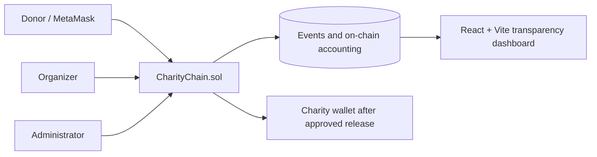

# CharityChain

CharityChain is a local-only educational mini project demonstrating how a smart contract can make donation and expense-release records auditable. It does **not** prove that a charity is genuine or that funds were used honestly; verification is an administrator approval in this prototype and evidence references are organizer-supplied.

## Architecture



The contract stores charity metadata, campaigns, donations, pending reservations, and approved releases. The frontend reads state and event logs directly using ethers.js. No database or backend is required.

## Requirements

- Node.js 18+ and npm
- VS Code
- MetaMask

## Windows setup

From the repository root in PowerShell:

```powershell
npm install
npm --prefix frontend install
npm run compile
```

Start a local chain in one terminal:

```powershell
npm run node
```

Copy one disposable private key printed by that command into MetaMask (never use it on mainnet). Add the network:

| Setting | Value |
|---|---|
| Network name | Hardhat Local |
| RPC URL | http://127.0.0.1:8545 |
| Chain ID | 31337 |
| Currency | ETH |

In a second terminal deploy the contract and generate its address/ABI for the frontend:

```powershell
npm run deploy
# Optional fictional demonstration record:
npm run seed
```

Start the UI:

```powershell
npm --prefix frontend run dev
```

Open the Vite URL, connect MetaMask, and register a charity. The deploy script must be rerun after restarting the local node because resetting the node erases all state. `seed` deploys a separate contract; use it only when you want the fictional demo record.

## Demonstration workflow

1. Use account 1 as the organizer and register a charity from **Charities**.
2. Use the administrator account (the deployer) to mark it administrator-approved.
3. Create a campaign for the organizer's charity.
4. Use any funded local account to donate test ETH from **Campaigns**.
5. Submit an expense request from **Expenses** and approve it as the administrator. Approval transfers the amount to the charity organizer wallet and emits `FundsReleased`.
6. Use **Blockchain ledger** to inspect confirmed donation events and their real transaction hashes.

Contract tests and frontend build:

```powershell
npm test
npm run build
```

## Contract surface

Key functions are `registerCharity`, `updateCharityVerification`, `createCampaign`, `setCampaignStatus`, `donate`, `requestExpense`, `approveExpense`, `rejectExpense`, `availableFunds`, and the read/list functions. Important events include `CharityRegistered`, `CharityVerificationUpdated`, `CampaignCreated`, `DonationReceived`, `CampaignStatusChanged`, `ExpenseRequested`, `ExpenseApproved`, `ExpenseRejected`, and `FundsReleased`.

Expense requests reserve funds immediately. Available funds are `totalRaised - totalReleased - reservedPending`; a campaign cannot reserve more than it has raised. Approval follows checks-effects-interactions and uses a checked low-level call, reverting safely if the transfer fails.

## Security and limitations

The administrator is a trusted approval authority. The contract has no arbitrary administrator withdrawal function and separates campaign accounting. This is not a professional audit or formal verification. Do not hold real donations with it without a security audit, legal review, identity controls, stronger governance, and independent oversight. On-chain evidence proves what the contract recorded, not the truth of an off-chain document or real-world impact.

Common issues:

- **No deployment / empty dashboard:** run `npm run node`, then `npm run deploy`; refresh the browser.
- **Wrong network:** select Hardhat Local (31337) in MetaMask.
- **Insufficient ETH:** import another disposable account printed by `npm run node`.
- **Failed transactions:** inspect the MetaMask error and ensure the connected account is the organizer or administrator required by the action.
- **Port conflict:** stop the process using port 8545 or change the Hardhat localhost URL and the MetaMask network consistently.
- **Dependency errors:** remove `node_modules` and rerun `npm install` and `npm --prefix frontend install`.

## Project limitations and future work

This prototype intentionally avoids real identity verification, IPFS, production key management, backend indexing, fiat donations, and mainnet deployment. Future work could add audited role management, independent charity due diligence, an indexed event service, privacy-preserving donor preferences, and multi-signature expense approvals.
